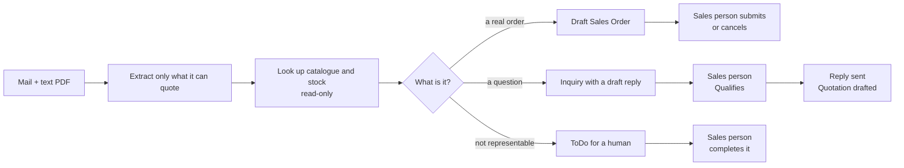

# Langorder-ai

**A customer email becomes an ERP record a sales person approves — not an order an AI placed.**

Sales teams already work in an ERP. This project reads a customer mail, proposes the document inside
ERPNext, and waits. Every approval and every reply stays where the sales person already works. All
names, mail and records here are fictional.



## What it does

- Reads a customer email and a text PDF, and keeps only facts it can quote from the source.
- Resolves each product line against the ERP catalogue and stock — read-only.
- Writes **one draft** Sales Order, or an `Inquiry`, or a ToDo. Never a submitted document.
- Sends a reply only after a human moves that `Inquiry` to `Qualified`, and only to a local mailbox.

It cannot approve anything: there is no approval screen in this repository, and the integration
account cannot submit or delete.

## Try it

```powershell
npm ci
npm test          # 103 deterministic tests: no network, no model calls
npm run doctor    # read-only checks: ERP reachable, token scoped, mailbox up
```

The full loop — mail in, Inquiry out, Qualify, reply delivered — is in the [runbook](docs/RUNBOOK.md).

## Model providers

Chosen explicitly with `MODEL_PROVIDER`. Nothing selects a model implicitly.

| `MODEL_PROVIDER` | Model | Status |
| --- | --- | --- |
| `gemini` (default) | `gemini-2.5-flash-lite` | verified |
| `local` | llama.cpp or Ollama on loopback, e.g. `qwen2.5:7b` | verified end to end |
| Bedrock Nova | `eu.amazon.nova-*` inference profiles | **not verified**: AWS account verification pending |

A small local model is never asked for character-exact quotes. It returns plain values and
`src/evidence.ts` locates them in the source, so a value that is not in the mail is still dropped.

## What is proven, and what is not

| Claim | Evidence |
| --- | --- |
| Deterministic behaviour | 103 tests; `npm run failure-lab` runs four failure scenarios against a mock ERP |
| Real ERP writes | draft Sales Order and draft Quotation created in ERPNext, confirmed by read-back |
| Human-only approval | the workflow resumes from ERP `docstatus`; the reconciler cannot approve anything |
| Reply loop | one Qualified Inquiry produced one reply in the sandbox mailbox; a second run sent none |
| Prompt injection | three attack mails left no ERP state change; a jailbroken model did paste an injected token into a draft reply, which never sends without a human |

Dated records, including what was not verified: [docs/verification.md](docs/verification.md).

## What it deliberately does not do

No DDoS or spam defence — the inbox is the trust boundary. No message queue, no multi-tenancy or
credential vault, no OCR, no authentication layer. Each is a decision with a reason:
[docs/decisions.md](docs/decisions.md).

## Read more

- [docs/RUNBOOK.md](docs/RUNBOOK.md) — how to run it, and what each command is for
- [docs/decisions.md](docs/decisions.md) — twelve decisions and the rejected options
- [docs/verification.md](docs/verification.md) — the dated evidence record

Engineering portfolio, not a production or ROI claim. Fictional data only.
